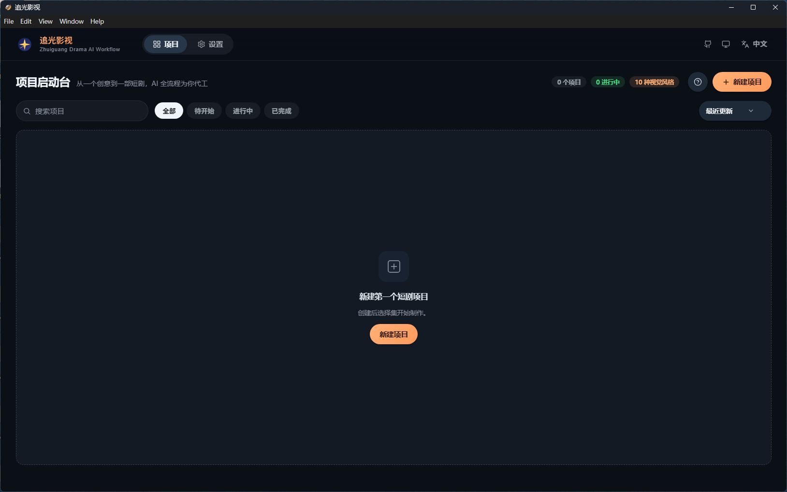
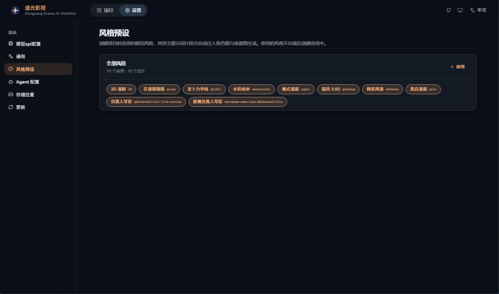

# 追光影视 · ZhuiguangDramaAI

> **从创意到短剧成片，AI 在本地桌面帮你走完全程。**  
> *From idea to finished short drama — AI runs the workflow on your desktop.*

桌面端 AI 短剧工作流客户端（Electron）。内置 **Seedance Skill OS** 与 **Grok Imagine** 框架，把立项、风格、剧本 / 分镜与图生视频收进同一套本地工作区。

[](https://github.com/helty2024/ZhuiguangDramaAI/releases/latest)
[](https://github.com/helty2024/ZhuiguangDramaAI/releases/tag/v2.4.1)
[](https://github.com/helty2024/ZhuiguangDramaAI/releases)

---

## 预览

<p align="center">
  
  <br />
  <em>项目启动台 — 从新建第一个短剧项目开始</em>
</p>

<p align="center">
  
  <br />
  <em>设置 · 风格预设 — 10 种视觉风格一键注入生成提示</em>
</p>

---

## 目录

- [这是什么](#这是什么)
- [当前版本亮点（v2.4.1）](#当前版本亮点v241)
- [下载](#下载)
- [安装](#安装)
- [快速开始](#快速开始)
- [应用内更新](#应用内更新)
- [系统要求](#系统要求)
- [版本历史](#版本历史)
- [常见问题](#常见问题)

---

## 这是什么

**追光影视（ZhuiguangDramaAI）** 是一款本地安装的短剧创作客户端：管理项目工作区、同步技能 / 框架模板，并接入视频与图像工作流（当前正式模板为 **seedance-2.0** 与 **grok-imagine-video-2.1**）。

本仓库公开内容为 **文档说明 + [Releases](https://github.com/helty2024/ZhuiguangDramaAI/releases) 安装包**，**不包含应用源码**。日常使用请直接下载发行包，无需自行编译。

### 它适合谁

| 你想… | 建议 |
|------|------|
| 在 Windows / Apple Silicon Mac 上装客户端开写 | 下最新 [v2.4.1](https://github.com/helty2024/ZhuiguangDramaAI/releases/tag/v2.4.1) |
| 核对安装包是否被篡改 | 用同名 `.sha256` 或下文校验值 |
| 跟版本说明 / 变更 | 看对应 Release 正文与本页「版本历史」 |

---

## 当前版本亮点（v2.4.1）

来自正式 Release 说明：

- **模型配置弹窗**：图像 / 视频标题改为「图像模型配置」「视频模型配置」；去掉官方预设 pill；支持添加自定义服务商
- **资产卡 UI**：左上角生成标签高对比底色 + 浅色字；角色卡名称 / 按钮 / 标签分行，避免重叠
- **小说体切换**：分镜工具条「小说体 / 标准」点击后高亮即时同步
- **VCE 镜头衔接**：右下角入口**仅在「视频制作」页显示**，其它版块隐藏
- **继承 2.4.0**：Seedance Skill OS、VCE 与 beforeGen、视频提示词标准 / 小说体、TEMPLATE_VERSION=**7**、无 grok-imagine-video-1.5、星标图标
- **双端包**：Windows x64 Setup + macOS arm64 DMG / ZIP

---

## 下载

**最新版：[v2.4.1](https://github.com/helty2024/ZhuiguangDramaAI/releases/tag/v2.4.1)** · 全部历史包见 [Releases](https://github.com/helty2024/ZhuiguangDramaAI/releases)

### Windows 10 / 11（x64）

| 文件 | 直链 |
|------|------|
| Setup 安装包 | [ZhuiguangDramaAI-2.4.1-Win10-11-x64-Setup.exe](https://github.com/helty2024/ZhuiguangDramaAI/releases/download/v2.4.1/ZhuiguangDramaAI-2.4.1-Win10-11-x64-Setup.exe) |
| SHA256 文件 | […Setup.exe.sha256](https://github.com/helty2024/ZhuiguangDramaAI/releases/download/v2.4.1/ZhuiguangDramaAI-2.4.1-Win10-11-x64-Setup.exe.sha256) |

```
SHA256 (Setup.exe)
8ff923fd77e9e2d1d601e09963c3953ae98b0d4adfd12e5c61f3b9ac122b15c4
```

### macOS（Apple Silicon / arm64）

| 文件 | 直链 |
|------|------|
| **推荐** DMG | [ZhuiguangDramaAI-2.4.1-macOS-arm64.dmg](https://github.com/helty2024/ZhuiguangDramaAI/releases/download/v2.4.1/ZhuiguangDramaAI-2.4.1-macOS-arm64.dmg) |
| 备用 ZIP | [ZhuiguangDramaAI-2.4.1-macOS-arm64.zip](https://github.com/helty2024/ZhuiguangDramaAI/releases/download/v2.4.1/ZhuiguangDramaAI-2.4.1-macOS-arm64.zip) |
| 说明 | [RELEASE-NOTES-MAC-v2.4.1.md](https://github.com/helty2024/ZhuiguangDramaAI/releases/download/v2.4.1/RELEASE-NOTES-MAC-v2.4.1.md) |

```
SHA256 (DMG)
7f71c4fc0f2d8871d8bd1b0dc27a87bf48a33fdcadc0cd2f9d147e4e45a8cbce

SHA256 (ZIP)
5e7f0fdcfbf4f7b1c95acdcee5cde5cdbf0ab34f2990b532716e7fa362bce1dc
```

> 以上均为 GitHub `releases/download/...` **真直链**（可被浏览器或客户端直接拉取，无需分享页）。

---

## 安装

### Windows

1. 关闭正在运行的「追光影视」
2. 运行 `ZhuiguangDramaAI-2.4.1-Win10-11-x64-Setup.exe`（通常需管理员）
3. 默认安装到 `C:\Program Files\ZhuiguangDramaAI`
4. 若旧目录无合法安装标记导致无法覆盖：先在「应用和功能」卸载旧版，再装本版（勿直接手删 Program Files）

PowerShell 校验示例：

```powershell
Get-FileHash .\ZhuiguangDramaAI-2.4.1-Win10-11-x64-Setup.exe -Algorithm SHA256
```

### macOS（arm64）

1. 退出旧版 → 打开 DMG → 将 App 拖到「应用程序」
2. 若 Gatekeeper 拦截：系统设置 → 隐私与安全性 → **仍要打开**
3. 说明：当前包为 **adhoc 签名、未公证**；仅支持 **Apple Silicon**

---

## 快速开始

1. 安装并启动「追光影视」
2. 按客户端引导配置所需 API（具体表单项以应用内为准；**本 README 不代填密钥**）
3. 在「项目启动台」新建短剧项目；升级后客户端会按模板版本同步 skills / frameworks
4. 在「设置 → 风格预设」选用视觉风格；确认工作流为 **seedance-2.0** / **grok-imagine-video-2.1**（若仍看到已移除的旧框架名，多为本地 AppData 残留目录，删除对应 `frameworks` 子目录后刷新即可）

> 视频 / 生图等能力按服务商计费。发布与打包过程**不会**替你代跑扣积分生成。

---

## 应用内更新

自 2.2 起，设置里的更新通道支持 **密码门 → 拉取 GitHub 安装包直链**。

- 回退下载地址形态：`https://github.com/helty2024/ZhuiguangDramaAI/releases/download/<tag>/<file>`
- 仓库为 **Public**，匿名即可下载 Release 资产
- 门禁密码以本机 `update-config.json` 中的 `update_download_password` 为准（勿把长期 `github_token` 打进公开包）

---

## 系统要求

| 平台 | 要求 |
|------|------|
| Windows | Windows 10 / 11，x64 |
| macOS | Apple Silicon（arm64）；Intel 未提供本版官方包 |
| 网络 | 访问 GitHub Releases（更新 / 首次下载）；以及你配置的模型 / 视频 API |

---

## 版本历史

| Tag | 摘要 |
|-----|------|
| **[v2.4.1](https://github.com/helty2024/ZhuiguangDramaAI/releases/tag/v2.4.1)** | 模型配置 / 资产卡 / 小说体 / VCE 仅视频页；Win + Mac；模板 version 7 |
| [v2.4.0](https://github.com/helty2024/ZhuiguangDramaAI/releases/tag/v2.4.0) | Win Setup；VCE / 小说体提示词等 |
| [v2.3.0](https://github.com/helty2024/ZhuiguangDramaAI/releases/tag/v2.3.0) | Seedance Skill OS v6.7.0 + Higgs 补丁；Win + Mac；模板 version 5 |
| [v2.2.0](https://github.com/helty2024/ZhuiguangDramaAI/releases/tag/v2.2.0) | Win Setup；密码门更新等 |
| [v2.1.0](https://github.com/helty2024/ZhuiguangDramaAI/releases/tag/v2.1.0) | Win Setup · Grok 2.1 |
| [v2.0](https://github.com/helty2024/ZhuiguangDramaAI/releases/tag/v2.0) | Win + Mac |
| 更早 | 见 [Releases](https://github.com/helty2024/ZhuiguangDramaAI/releases) |

详细变更以各 Release 正文与附件 `RELEASE-NOTES-*.md` 为准。仓库内 [`RELEASE_NOTES.md`](./RELEASE_NOTES.md) 仅保留早期 v1 构建备忘，**请勿当作最新版说明**。

---

## 常见问题

### 本仓库有应用源码吗？

**没有。** 本仓库仅公开 **README / 说明文档** 与 **Releases 安装包**，不提供客户端源码，也无法从本仓自行编译出完整应用。请使用 [Releases](https://github.com/helty2024/ZhuiguangDramaAI/releases) 中的官方安装包。

### 下载很慢 / 被墙？

直链依赖 GitHub。可换网络、镜像，或把同一文件放到自有 CDN 后改客户端 `fallback_download_url`。

### Mac 提示「无法打开，因为无法验证开发者」？

本版未公证。按系统提示在「隐私与安全性」中选择仍要打开，或右键 → 打开。

### 设置里还能看到 grok-imagine-video-1.5？

自 v2.3.0 起模板已移除该框架（v2.4.1 仍不包含）。若列表仍出现，通常是 `%APPDATA%\ZhuiguangDramaAI\workspace\frameworks\`（或 Mac 对应 Application Support）下的**旧目录残留**，删掉该文件夹后重开设置即可。

### 安装时 Abort / 无法覆盖？

多见于旧目录缺少合法 marker。请先卸载旧「追光影视」，再装 2.4.1。

---

**追光影视 · ZhuiguangDramaAI** — 下载最新安装包 → [Releases · v2.4.1](https://github.com/helty2024/ZhuiguangDramaAI/releases/tag/v2.4.1)
